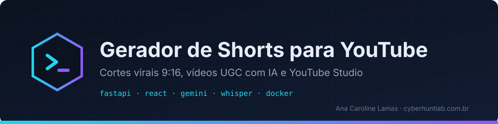

<p align="center"></p>

# Gerador de Shorts para YouTube — plataforma de vídeos curtos com IA

Versão adaptada do projeto de código aberto **[OpenShorts](https://github.com/mutonby/openshorts)**, uma plataforma auto-hospedável de vídeo com IA que reúne três ferramentas: **gerador de cortes** (vídeos longos → Shorts 9:16), **AI Shorts** (vídeos de marketing UGC com atores gerados por IA) e **YouTube Studio** (miniaturas, títulos e descrições). Roda com Docker, sem marca d'água.

> **Adaptações desta versão:**
> - aceita **URL do YouTube** (download via Vid Kraken, `VIDKRAKEN_API_KEY`, ou RapidAPI, `RAPIDAPI_KEY`) além de upload local;
> - **cadastro e login** com SQLite e sessão em cookie (`auth.py`);
> - **editor de clipes** (`/api/edit`), legendas, ganchos, tradução e efeitos por endpoints próprios;
> - a análise de momentos virais usa o **Google Gemini**, e a publicação via Upload-Post é opcional.

Documentação original em inglês: [README-en.md](README-en.md).

## Recursos

### Gerador de cortes
- Entrada por **URL do YouTube** ou upload de arquivo.
- Detecção de **3 a 15 momentos virais** a partir da transcrição e das mudanças de cena (PySceneDetect).
- **Recorte 9:16** em dois modos: rastreamento de rosto (MediaPipe + YOLOv8) ou fundo desfocado.
- **Legendas automáticas** com faster-whisper e marcação por palavra.
- **Dublagem** com ElevenLabs, textos de gancho e efeitos de vídeo via FFmpeg.

### AI Shorts (vídeos UGC)
- Análise do site ou da descrição do produto, roteiro (gancho, problema, solução e CTA), ator gerado por IA (fal.ai), narração (ElevenLabs), *lip-sync*, B-roll e montagem final com legendas.

### YouTube Studio
- 10 sugestões de título com chat de refinamento, miniatura com rosto e descrição com capítulos.

### Publicação e infraestrutura
- Publicação e agendamento no TikTok, Instagram Reels e YouTube Shorts via Upload-Post.
- Galeria pública com páginas de SEO (JSON-LD), backup em S3 e fila de tarefas assíncrona.

## Instalação

Requisitos: **Docker** e Docker Compose; chaves do **Google Gemini** e do **RapidAPI** (downloads do YouTube) e, para os recursos completos, **fal.ai**, **ElevenLabs** e **Upload-Post** (opcional).

```bash
git clone https://github.com/ticarollamas-arch/GeradorShorts-Youtube.git
cd GeradorShorts-Youtube
cp .env.example .env        # RAPIDAPI_KEY e, opcionalmente, S3
```

| Variável (servidor) | Uso |
|---|---|
| `VIDKRAKEN_API_KEY` | Download de vídeos do YouTube via Vid Kraken (usado quando definido) |
| `RAPIDAPI_KEY` | Download via RapidAPI (alternativa padrão) |
| `AUTH_DB_PATH` | Caminho do banco SQLite de usuários (padrão `data/users.db`) |
| `AWS_ACCESS_KEY_ID`, `AWS_SECRET_ACCESS_KEY`, `AWS_REGION`, `AWS_S3_BUCKET`, `AWS_S3_PUBLIC_BUCKET` | Backup e galeria em S3 (opcional) |
| `MAX_CONCURRENT_JOBS` | Limite de tarefas simultâneas (padrão 5) |

As chaves do Gemini, fal.ai, ElevenLabs e Upload-Post são informadas no painel e guardadas cifradas no navegador.

## Como usar

```bash
docker compose up --build
```

Abra `http://localhost:5175`, cadastre as chaves em **Settings** e escolha a ferramenta: **Clip Generator** (cole uma URL do YouTube ou envie um vídeo), **AI Shorts** (descreva o produto ou cole uma URL) ou **YouTube Studio**.

## Tecnologias

Python 3.11 · FastAPI · faster-whisper · YOLOv8 (Ultralytics) · MediaPipe · PySceneDetect · yt-dlp · RapidAPI · FFmpeg · Google Gemini · SQLite · React 18 · Vite · Tailwind CSS · Remotion · fal.ai · ElevenLabs · Upload-Post · AWS S3 · Docker Compose

## Créditos

Projeto original: [OpenShorts](https://github.com/mutonby/openshorts), de mutonby e colaboradores. O aviso de copyright original está preservado em [LICENSE](LICENSE).

## Licença

MIT. Veja [LICENSE](LICENSE) (Copyright © 2024 OpenShorts).
